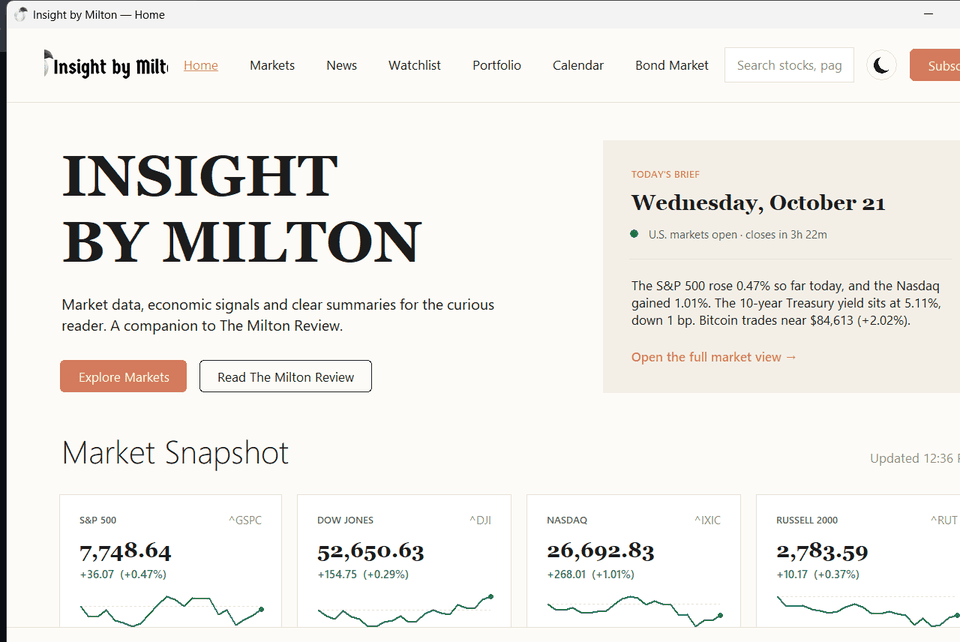

<p align="center">
  <picture>
    <source media="(prefers-color-scheme: dark)" srcset="assets/logo-dark.png">
    
  </picture>
</p>

<p align="center">
  A desktop markets companion for <a href="https://www.themiltonreview.net"><strong>The Milton Review</strong></a>
  &nbsp;·&nbsp; Built with Python &amp; Tkinter
</p>

<p align="center">
  
  
  
  
</p>

<br>

<p align="center">
  <picture>
    <source media="(prefers-color-scheme: dark)" srcset="assets/demo-dark.gif">
    
  </picture>
</p>

---

## About

Insight by Milton is a desktop app built by **Aidan Bologna** as a companion to [The Milton Review](https://www.themiltonreview.net) — an independent finance publication focused on clear, accessible market commentary.

The idea started simply: give Milton Review readers a native Windows app that shows the same data the articles talk about, styled to match the site. It grew from a 189-line prototype in June 2026 into a full seven-page application across ten versions — adding fundamentals analysis, 24 curated news outlets with political bias ratings, a portfolio tracker, price alerts, an economic calendar, and more.

Everything is built with Python's standard library and a small set of open-source packages. No subscription, no account, no telemetry. Market data comes from Yahoo Finance; news comes straight from each publisher's RSS feed; economic calendar data is pulled from official U.S. government sources.

| | |
|---|---|
| **Author** | Aidan Bologna |
| **Publication** | [The Milton Review](https://www.themiltonreview.net) |
| **Contact** | [aidanbologna@themiltonreview.net](mailto:aidanbologna@themiltonreview.net) |
| **Built with** | Python 3.10+ · Tkinter · yfinance · matplotlib · Pillow |
| **Platform** | Windows 10/11 |
| **Started** | June 2026 |
| **Current version** | v10 (October 2026) |

---

## Pages

<table>
<tr>
<td><strong>🏠 Home</strong></td>
<td>Today's Brief, Market Snapshot with sparklines, Milton Review articles, Today's Movers, rotating investor quotes</td>
</tr>
<tr>
<td><strong>📈 Markets</strong></td>
<td>Market overview (indices, sectors, largest companies) · per-stock charts 1D–MAX · moving averages · volume · fundamentals · compare up to 5 stocks</td>
</tr>
<tr>
<td><strong>📰 News</strong></td>
<td>24 outlets ordered left→right by <a href="https://www.allsides.com/media-bias">AllSides</a> bias rating · topic chips · instant filter · <strong>FREE / LIMITED / PAYWALL</strong> tags on every article</td>
</tr>
<tr>
<td><strong>⭐ Watchlist</strong></td>
<td>Live prices, sparklines, sortable columns, price alerts with Windows notifications</td>
</tr>
<tr>
<td><strong>💼 Portfolio</strong></td>
<td>Holdings · gains · allocation donut · performance vs S&amp;P 500 · dividend income · CSV import/export (Fidelity, Schwab, Vanguard, Robinhood…) · sell shares with realized gain history</td>
</tr>
<tr>
<td><strong>📅 Calendar</strong></td>
<td>Earnings &amp; dividends for your watchlist/portfolio · Fed rate decisions · CPI · jobs report · GDP · PCE · retail sales</td>
</tr>
<tr>
<td><strong>🏦 Bond Market</strong></td>
<td>Live Treasury yield curve vs 1 month / 1 year ago · 2s10s &amp; 3M–10Y spread signals · recession watch</td>
</tr>
</table>

**Search everything — `Ctrl+K`** &nbsp; Stocks, pages, actions, news outlets, your holdings, price alerts, calendar events and plain-English explanations (P/E, yield curve, ex-dividend date…).

**Dark mode** &nbsp; Follows Windows on first launch; toggle with the ☀︎/☽ button.

---

## Quick start

```bash
pip install -r requirements.txt
python insightByMilton.py
```

### Build the Windows app

Double-click **`build.bat`**, or:

```bat
python -m PyInstaller --noconfirm --windowed --name insightByMilton ^
    --icon icon.ico --add-data "assets;assets" --add-data "icon.ico;." ^
    insightByMilton.py
```

Output: `dist\insightByMilton\insightByMilton.exe` &nbsp;·&nbsp; See [`installers/`](installers/) for Linux and macOS.

> **Windows SmartScreen** &nbsp; On first launch click **"More info" → "Run anyway"**. The exe is unsigned — SmartScreen blocks all unsigned apps regardless of content.

---

## News sources

Ratings are [AllSides Media Bias Ratings](https://www.allsides.com/media-bias), checked October 2026.

| Rating | Outlets |
|---|---|
| Left | The Guardian |
| Lean Left | CNBC · The Economist · The New York Times · NPR · Business Insider · CBS News |
| Center | WSJ · MarketWatch · Bloomberg · Financial Times · BBC News · Forbes · The Hill · Fortune · Quartz · Reason |
| Lean Right | Fox Business · Washington Examiner · The Washington Times · Investor's Business Daily |
| Right | New York Post · Breitbart News · The Daily Signal |

---

## Version history

Browse the full history on the [Releases](../../releases) page or the [Commits](../../commits/main) tab.

| | Version | Highlights |
|---|---|---|
| v10 | Paywall Labels & Better Stock News | FREE / LIMITED / PAYWALL tags · improved stock headline matching |
| v9 | Selling & App Search | Sell shares · sales history · Ctrl+K universal search |
| v8 | Portfolio CSV Import | Broker CSV import · drag & drop · export CSV |
| v7 | Portfolio, Calendar & Dark Mode | Portfolio tab · Calendar tab · price alerts · dark mode |
| v6 | Speed & Quality of Life | 4× faster charts · 24 outlets · keyboard shortcuts · window state memory |
| v5 | Chart Screenshots | Branded PNG/JPEG export from every chart |
| v4 | News Sources & Speed | 16 RSS outlets · source pages with bias scale · Markets overview |
| v3 | Fundamentals | Colour-coded fundamental analysis with tooltips and popup |
| v2 | Milton Redesign | Full UI redesign matching themiltonreview.net · all 5 pages live |
| v1 | Original | First prototype — stock chart + Treasury yield curve |

---

## Requirements

```
yfinance>=1.0   pandas   numpy   matplotlib   pillow   tzdata   win11toast   tkinterdnd2
```

App data (watchlist, portfolio, settings, alerts) is stored in `%APPDATA%\InsightByMilton` — never bundled in the exe.

---

## Disclaimer

Educational commentary only — nothing in this app is financial advice. Market data comes from Yahoo Finance via the unofficial `yfinance` library and may be delayed. Headlines and images belong to their publishers; the app links to the original articles.

---

<p align="center">
  © 2026 The Milton Review &nbsp;·&nbsp;
  <a href="mailto:aidanbologna@themiltonreview.net">aidanbologna@themiltonreview.net</a> &nbsp;·&nbsp;
  <a href="https://www.themiltonreview.net">themiltonreview.net</a>
</p>
